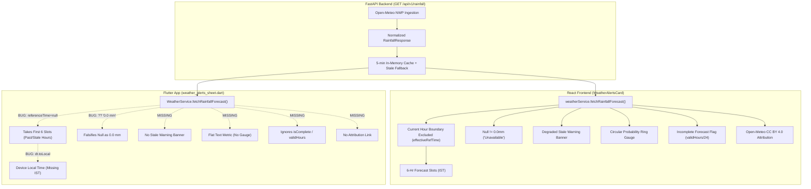
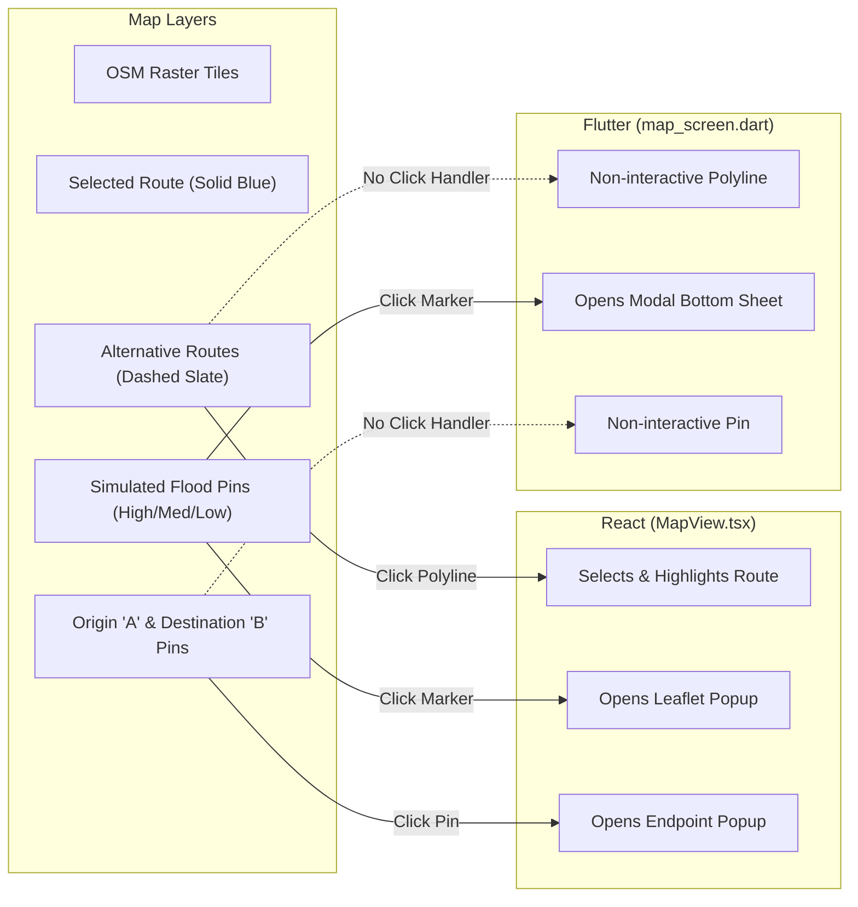

# VARSHA: Comprehensive React vs. Flutter Feature Parity Audit

**Audit Date**: November 2026  
**Auditor**: Antigravity DeepMind Core Engineering Agent  
**Reference Implementation (Source of Truth)**: `C:\Users\Prem\Desktop\VARSHA\frontend` (React 18 + TypeScript + Vite)  
**Target Implementation**: `C:\Users\Prem\Desktop\VARSHA-Flutter\flutter_app` (Flutter 3.24+ / Dart 3.5+)  
**Shared Backend**: `C:\Users\Prem\Desktop\VARSHA-Flutter\backend` (FastAPI + Pydantic v2 + Redis/Open-Meteo/SACHET)  
**Audit Mode**: Strictly Read-Only (Source code inspection, algorithmic verification, and API contract analysis; no application or backend code modified)

---

## Section 1 – Executive Summary

### 1.1 Overall Parity Assessment
The migration from the React frontend to the Flutter mobile application successfully reproduced the core navigational and algorithmic scaffolding of VARSHA:
- The custom equirectangular point-to-segment hazard proximity engine and the 0–100 stepped risk scoring algorithm (`1.0`, `0.75`, `0.5` multipliers) are mathematically identical across both codebases and pass all unit tests.
- The dual parallel corridor injection logic (Palm Beach Road and Kopar Khairane West Bypass) and OSRM integration are structurally equivalent.
- The 4 demo scenarios (Baseline, Flood on Highway, Flood on West Bypass, All Clear) correctly alter hazard datasets and trigger differential route safety assessments.
- The forward geocoding place search with 20 curated Navi Mumbai landmarks fallback is fully operational.
- Flutter introduced mobile-first improvements, including an in-app `SettingsSheet` with live `/api/v1/health` connectivity testing, runtime IP/base URL persistence via `SharedPreferences`, and camera fitting to route bounds.

**However, critical omissions, data-integrity violations, and behavioral regressions exist in Flutter—specifically within the Weather and Disaster Alerts subsystems.** The previous migration audit incorrectly assumed that because `weather_alerts_sheet.dart` existed, the feature was complete. In reality, the Flutter implementation omitted critical data fields, failed to enforce temporal boundary rules, dropped degraded/stale provider feedback, fabricated 0.0 mm rainfall on null model outputs, omitted alert timeline and urgency metadata, lost interactive map polyline taps, and left GPS location services disconnected.

### 1.2 Most Significant Missing Features & Regressions

1. **Weather Current-Hour Cutoff & Temporal Boundary Failure (`selectNextSixForecastHours`)**:
   - In React, `selectNextSixForecastHours` strictly excludes the current hour interval (`step.timestamp <= currentHourStart`) so commuters only see upcoming future forecast hours.
   - In Flutter, `weather_alerts_sheet.dart` invokes `selectNextSixForecastHours(_rainfall?.hourly)` without passing a `referenceTime`. Because `weather.dart` only calculates a cutoff when `referenceTime != null`, the cutoff is `null`, and Flutter simply slices the first 6 elements of the hourly array—displaying past intervals from midnight or early morning rather than upcoming future hours.
   - Flutter formats hourly timestamps using device-local time (`.toLocal()`) with hardcoded `:00` suffixes instead of Indian Standard Time (`Asia/Kolkata` / IST), displaying incorrect times if the device is set to UTC or another time zone.

2. **Null Rainfall Falsification (Domain Rule Violation)**:
   - The FastAPI backend contract explicitly specifies: *"0.0 mm represents a valid model forecast of zero rainfall; missing, failed, or unmeasured intervals are represented as None/null. Provider failures return an explicit unavailable state, never a zero-rainfall report."*
   - React correctly checks `rainfall.current?.precipitation_mm !== null` and displays `"Unavailable"` when missing.
   - Flutter's `weather_alerts_sheet.dart` executes `_rainfall!.current?.precipitationMm != null ? ... : '0.0 mm'`, falsifying missing data as zero rainfall ("0.0 mm").

3. **Missing Stale Cache & Provider Health Indicators**:
   - In React, when Open-Meteo or NDMA SACHET is unreachable and the backend serves cached data (`is_stale == true` or `status == 'degraded'`), prominent amber banners warn the user: *"Notice: Open-Meteo upstream is currently unreachable. Displaying cached forecast from [timestamp]"* and *"⚠ Stale Fallback"*.
   - Flutter completely ignores `isStale` and `provider.status == 'degraded'`. Users have no way of knowing whether weather or alerts data is live or stale.
   - In Flutter, HTTP 200 responses with `provider.status == 'unavailable'` are treated as successes rather than error states.

4. **Missing Alert Urgency, Event Badges, and Expiration Timelines**:
   - React's `WeatherAlertsCard` presents a structured timeline: `Effective: [Date/Time IST] • Expires: [Date/Time IST]`, along with `[Urgency] Urgency` badges, `[Event]` badges, and affected district lists.
   - Flutter's `WeatherAlertsSheet` omits all alert timestamps (`effective`, `expires`), drops the urgency badge, drops the event badge, and abbreviates the area heading.

5. **Weather & Alerts Provider Attribution Missing**:
   - React provides required legal attributions linking to Open-Meteo (CC BY 4.0) and NDMA SACHET (CAP 1.2).
   - Flutter omits both attribution notices entirely.

6. **Missing 24-Hour Summary Incomplete Indicators & Ring Gauge**:
   - React displays an SVG circular progress gauge for `max_probability_pct` and detects incomplete forecasts (`validHours < forecastHours`), warning: `* Incomplete forecast: X of 24 hourly intervals were missing from upstream model output.`
   - Flutter only renders a flat text tile and ignores forecast completeness.

7. **Interactive Map Polyline and Pin Taps Omitted**:
   - In React, tapping an alternative dashed route line directly on the map selects and highlights that route. In Flutter, polylines are non-interactive; selection is only possible via bottom sheet cards.
   - In React, tapping Origin (A) or Destination (B) pins displays coordinate popups. In Flutter, endpoint markers ignore taps.

8. **Location Service Dead Code**:
   - `LocationService` was created in `lib/services/location/location_service.dart` with `geolocator` integration, but is never imported or called in any UI screen.

9. **Branding & Hackathon References Remaining**:
   - `about_sheet.dart` and `README.md` contain references to the "MY Bharat Hackathon" and "Independent college mini project".

---

## Section 2 – Feature Comparison Matrix

| # | Feature / Capability | React Source (`VARSHA/frontend`) | Flutter Target (`flutter_app`) | Status | Exact Difference / Missing Behavior | Backend Dependency |
| :- | :--- | :--- | :--- | :--- | :--- | :--- |
| **A. WEATHER** | | | | | | |
| A.1 | Current model estimate display | `src/features/weather/WeatherAlertsCard.tsx` (lines 383–398) | `lib/features/weather/weather_alerts_sheet.dart` (lines 244–296) | **Different** | React displays `"Unavailable"` when `precipitation_mm` is `null`. Flutter falls back to `"0.0 mm"`, fabricating zero rainfall on missing data. React dynamically renders window size (`15m window`); Flutter hardcodes it. | `GET /api/v1/rainfall` (`current` object) |
| A.2 | 6-hour hourly forecast filtering | `src/features/weather/WeatherAlertsCard.tsx` (lines 73–123) | `lib/models/weather.dart` (lines 231–272) & `weather_alerts_sheet.dart` (line 124) | **Partial** | React strictly excludes current hour using `currentHourStart` cutoff from `effectiveRefTime`. Flutter calls `selectNextSixForecastHours(_rainfall?.hourly)` without `referenceTime`, leaving cutoff `null` and slicing initial/past hours. | `GET /api/v1/rainfall` (`hourly` array) |
| A.3 | Hourly timestamp formatting & Timezone | `src/features/weather/WeatherAlertsCard.tsx` (lines 46–61) | `lib/features/weather/weather_alerts_sheet.dart` (lines 316–323) | **Different** | React formats timestamps explicitly in IST (`Asia/Kolkata`) with 12-hour AM/PM and minutes. Flutter uses `dt.toLocal()` (device local time, not IST) and hardcodes `:00`. Header in React includes `(IST)`; Flutter omits it. | None (Client formatting) |
| A.4 | Hourly accumulation & probability cards | `src/features/weather/WeatherAlertsCard.tsx` (lines 400–430) | `lib/features/weather/weather_alerts_sheet.dart` (lines 300–368) | **Complete** | Both render horizontal slot cards displaying mm accumulation and rounded % probability. | `GET /api/v1/rainfall` (`hourly[].precipitation_mm`, `hourly[].precipitation_probability_pct`) |
| A.5 | 24-hour summary metrics | `src/features/weather/WeatherAlertsCard.tsx` (lines 432–540) | `lib/features/weather/weather_alerts_sheet.dart` (lines 372–426) | **Partial** | Flutter displays Total, Peak 1-Hour, and Max Probability metrics, but omits: 1) circular probability ring gauge, 2) partial forecast warning (`validHours < forecastHours`), 3) summary unavailable fallback text. | `GET /api/v1/rainfall` (`summary` object) |
| A.6 | Weather stale / degraded banner | `src/features/weather/WeatherAlertsCard.tsx` (lines 376–380) | `lib/features/weather/weather_alerts_sheet.dart` | **Missing** | React displays an explicit warning when Open-Meteo upstream is unreachable and cached fallback is served. Flutter completely omits stale warnings. | `GET /api/v1/rainfall` (`provider.is_stale`, `provider.status == 'degraded'`) |
| A.7 | Weather provider freshness badge | `src/features/weather/WeatherAlertsCard.tsx` (lines 350–355) | `lib/features/weather/weather_alerts_sheet.dart` | **Missing** | React displays `Fetched: [Timestamp IST]` or `⚠ Stale Fallback`. Flutter displays a static string without retrieval time or stale status. | `GET /api/v1/rainfall` (`provider.retrieved_at`) |
| A.8 | Weather loading & error states | `src/features/weather/WeatherAlertsCard.tsx` (lines 358–373) | `lib/features/weather/weather_alerts_sheet.dart` (lines 240–242) | **Partial** | Flutter catches network exceptions, but fails to check `res.provider.status == 'unavailable'` on HTTP 200 responses. React shows a dedicated spinner while loading; Flutter only shows a spinner on the app bar refresh icon. | `GET /api/v1/rainfall` |
| A.9 | Weather client cache & deduplication | `src/features/weather/weatherService.ts` (lines 22–32, 75–85) | `lib/services/weather/weather_service.dart` (lines 20–29, 43–61) | **Different** | React uses a module-level cache that persists across UI opens. Flutter defines the cache on the `WeatherService` instance, but `weather_alerts_sheet.dart` instantiates `WeatherService()` in `initState()`, wiping the cache whenever the sheet closes. | None |
| A.10 | Weather Open-Meteo attribution | `src/features/weather/WeatherAlertsCard.tsx` (lines 543–554) | `lib/features/weather/weather_alerts_sheet.dart` | **Missing** | React provides an attribution link to Open-Meteo under CC BY 4.0. Flutter omits this in the weather sheet. | None |
| **B. DISASTER ALERTS** | | | | | | |
| B.1 | NDMA SACHET alert feed query | `src/features/weather/weatherService.ts` (lines 137–175) | `lib/services/weather/weather_service.dart` (lines 106–145) | **Complete** | Both query `GET /api/v1/alerts?active_only=true` and deserialize into normalized alert models. | `GET /api/v1/alerts` |
| B.2 | Alert severity badge & color coding | `src/features/weather/WeatherAlertsCard.tsx` (lines 125–138, 618–620) | `lib/features/weather/weather_alerts_sheet.dart` (lines 108–120, 494–508) | **Complete** | Both assign distinct colors to Extreme, Severe, Moderate, and Minor severities. | `GET /api/v1/alerts` (`alerts[].severity`) |
| B.3 | Alert event & urgency badges | `src/features/weather/WeatherAlertsCard.tsx` (lines 621–626) | `lib/features/weather/weather_alerts_sheet.dart` | **Missing** | React renders dedicated chips for `alert.event` and `alert.urgency` ("Expected Urgency", "Immediate Urgency"). Flutter omits both chips entirely. | `GET /api/v1/alerts` (`alerts[].event`, `alerts[].urgency`) |
| B.4 | Alert validity timeline (Effective / Expires) | `src/features/weather/WeatherAlertsCard.tsx` (lines 641–652) | `lib/features/weather/weather_alerts_sheet.dart` | **Missing** | React displays `Effective: [time]` and `Expires: [time]` formatted in IST. Flutter displays zero timestamp or validity info on alert cards. | `GET /api/v1/alerts` (`alerts[].effective`, `alerts[].expires`) |
| B.5 | Expandable description & instructions | `src/features/weather/WeatherAlertsCard.tsx` (lines 655–682) | `lib/features/weather/weather_alerts_sheet.dart` (lines 532–577) | **Complete** | Both provide an accordion button toggling detailed advisory text and recommended public instructions. | `GET /api/v1/alerts` (`alerts[].description`, `alerts[].instruction`) |
| B.6 | Alert affected area description | `src/features/weather/WeatherAlertsCard.tsx` (lines 635–639) | `lib/features/weather/weather_alerts_sheet.dart` (lines 525–531) | **Complete** | Both render textual district/locality descriptions from CAP area blocks. | `GET /api/v1/alerts` (`alerts[].area_description`) |
| B.7 | Alert stale cache warning banner | `src/features/weather/WeatherAlertsCard.tsx` (lines 588–592) | `lib/features/weather/weather_alerts_sheet.dart` | **Missing** | React warns when NDMA SACHET feed is unreachable and cached alerts are shown. Flutter omits stale alerts warnings. | `GET /api/v1/alerts` (`provider.is_stale`, `provider.status == 'degraded'`) |
| B.8 | Alert empty state (0 active) | `src/features/weather/WeatherAlertsCard.tsx` (lines 594–606) | `lib/features/weather/weather_alerts_sheet.dart` (lines 441–475) | **Complete** | Both distinguish 0 active alerts from service failures, explaining that local waterlogging can still occur. | `GET /api/v1/alerts` (`total == 0`) |
| B.9 | Alert provider attribution | `src/features/weather/WeatherAlertsCard.tsx` (lines 690–693) | `lib/features/weather/weather_alerts_sheet.dart` | **Missing** | React attributes NDMA SACHET (CAP 1.2). Flutter omits attribution in the alerts sheet. | None |
| B.10 | Alert display on map | None | None | **Complete** | Neither application renders alert polygons on the map; both restrict official alerts to sheets/cards to avoid false spatial precision. | `GET /api/v1/alerts` |
| **C. MAP & HAZARDS** | | | | | | |
| C.1 | OpenStreetMap base layer | `src/features/map/MapView.tsx` (lines 294–304) | `lib/features/map/map_screen.dart` (lines 343–356) | **Complete** | Leaflet raster tiles in React; `flutter_map` with `TileLayer` in Flutter. Center (19.0330, 73.0297), zoom 12.0. | None (Public OSM tile servers) |
| C.2 | User location / GPS tracking | None (Fixed pilot center) | `lib/services/location/location_service.dart` | **Different** | React does not use GPS. Flutter implemented `LocationService` with `geolocator`, but left it completely disconnected from UI. | None |
| C.3 | Hazard marker representation | `src/features/map/HazardMarkers.tsx` (lines 8–30) | `lib/features/map/hazard_markers_layer.dart` (lines 168–223) | **Complete** | Both render High, Medium, and Low severity color-coded pulsing pins. | None (Simulated dataset) |
| C.4 | Hazard detail inspection | `src/features/map/HazardMarkers.tsx` (lines 59–99) | `lib/features/map/hazard_markers_layer.dart` (lines 23–165) | **Different** | React opens Leaflet popup above pin. Flutter displays modal bottom sheet. Information content is identical. | None |
| C.5 | Endpoint markers (Origin A, Dest B) | `src/features/map/RouteEndpointMarkers.tsx` | `lib/features/map/endpoint_markers_layer.dart` | **Partial** | Visual pins identical. In React, clicking a pin opens a popup showing coordinate details. In Flutter, pins ignore taps. | None |
| C.6 | Interactive polyline selection on map | `src/features/map/MapView.tsx` (lines 307–327) | `lib/features/map/route_polyline_layer.dart` | **Missing** | In React, clicking an unselected alternative dashed line on the map highlights it. In Flutter, polylines ignore taps. | None |
| C.7 | Map legend overlay | `src/features/map/MapView.tsx` (lines 352–414) | `lib/features/map/map_legend.dart` | **Complete** | Both provide collapsible pill explaining pins, route lines, and hazard severities. | None |
| C.8 | Camera fitting to route bounds | None (Static map view) | `lib/features/map/map_screen.dart` (lines 262–270) | **Different** | Flutter automatically animates camera to fit route bounds. React maintains static zoom. | None |
| **D. ROUTING** | | | | | | |
| D.1 | Origin/Destination place search & geocoding | `src/features/search/placesService.ts` | `lib/services/places/places_service.dart` | **Complete** | Both query `/api/v1/places/search?q=...&limit=5` with 350ms debounce and coordinate validation. | `GET /api/v1/places/search` |
| D.2 | Curated landmarks fallback search | `src/features/search/landmarks.ts` | `lib/models/place.dart` (lines 120–324) | **Complete** | Both maintain identical 20-item Navi Mumbai landmark directory with fuzzy/substring matching. | None |
| D.3 | OSRM routing engine integration | `src/features/routing/osrmService.ts` | `lib/services/routing/osrm_service.dart` | **Complete** | Both query OSRM driving service requesting up to 3 alternatives with 500m endpoint validation. | OSRM Router (`https://router.project-osrm.org`) |
| D.4 | Parallel corridor waypoint injection | `src/features/routing/corridors.ts` | `lib/services/routing/corridors.dart` | **Complete** | Both inject Palm Beach Road (Vashi–Belapur) and West Bypass (Airoli–Vashi) waypoints when 1 route returned. | OSRM Router |
| D.5 | Alternative route deduplication | `src/features/routing/corridors.ts` (lines 108–135) | `lib/services/routing/corridors.dart` (lines 88–114) | **Complete** | Identical logic: 250m distance difference, 45s duration difference, 75m midpoint divergence check. | None |
| D.6 | Comparative trade-off badges | `src/features/map/RouteSelector.tsx` (lines 414–430) | `lib/features/routing/route_comparison_view.dart` (lines 193–204) | **Complete** | Both compute and display `🛡️ Recommended / Safer`, `⚡ Fastest Estimate`, and `📏 Shortest Distance`. | None |
| D.7 | Hazard proximity distance calculations | `src/features/routing/hazardProximity.ts` | `lib/services/routing/hazard_proximity.dart` | **Complete** | Equirectangular projection with R=6,371,000m, segment clamping `[0, 1]`, and 100m threshold. | None |
| D.8 | Explainable route risk scoring | `src/features/routing/routeRiskScoring.ts` | `lib/services/routing/route_risk_scoring.dart` | **Complete** | Base weights (10, 20, 35), stepped multipliers (1.0, 0.75, 0.5), clamping to [0, 100], identical categories. | None |
| D.9 | Pick on Map interactive mode | `src/features/map/MapView.tsx` (lines 112–153, 243–261) | `lib/features/map/map_screen.dart` (lines 155–215, 375–425) | **Complete** | Both display top banner and advance target to destination automatically. | None |
| D.10 | Popular route quick presets | `src/features/map/RouteSelector.tsx` (lines 523–582) | `lib/features/routing/route_planner_sheet.dart` (lines 284–353) | **Complete** | Both provide Vashi → Belapur, Airoli → Kharghar, and Nerul → Seawoods presets. | None |
| **E. SCENARIOS** | | | | | | |
| E.1 | 4 Demo risk scenarios | `src/features/scenarios/scenarios.ts` | `lib/models/scenario.dart` | **Complete** | Baseline (5 hazards), Flood on Highway (1 hazard), Flood on West Bypass (1 hazard), All Clear (0 hazards). | None |
| E.2 | Scenario selector UI & warnings | `src/features/scenarios/ScenarioSelector.tsx` | `lib/features/scenarios/scenario_selector.dart` | **Complete** | Segmented choice chips with prominent synthetic hazard warning notices. | None |
| E.3 | Dynamic route risk recalculation on scenario change | `src/features/map/MapView.tsx` (lines 88–91) | `lib/features/map/map_screen.dart` (lines 508–514) | **Complete** | Changing scenario immediately re-evaluates risk scores for all active routes. | None |
| **F. SHELL & APP** | | | | | | |
| F.1 | Top status strip header | `src/App.tsx` (lines 101–162) | `lib/features/shell/top_status_strip.dart` | **Complete** | VARSHA wordmark, pilot badge, live rain summary, alert count badge, refresh trigger. | None |
| F.2 | Persistent bottom disclaimer strip | `src/App.tsx` (lines 170–188) | `lib/features/shell/persistent_disclaimer.dart` | **Complete** | "Simulated data prototype • Navi Mumbai pilot • Not for emergency navigation • Learn more". | None |
| F.3 | About drawer / modal | `src/App.tsx` (lines 236–383) | `lib/features/shell/about_sheet.dart` | **Partial** | Accordions and data sources match, but both contain uncleaned hackathon credits. | None |
| F.4 | In-app API Base URL & Settings | None (Vite compile-time env) | `lib/features/settings/settings_sheet.dart` | **Different** | Flutter adds runtime configuration modal with live `/api/v1/health` ping and `SharedPreferences` persistence. | `GET /api/v1/health` |
| F.5 | Mobile responsive bottom sheet layout | `src/components/BottomSheet.tsx` | `lib/features/map/map_screen.dart` (`DraggableScrollableSheet`) | **Complete** | Flutter uses native Flutter gestures (`DraggableScrollableSheet` snap sizes [0.12, 0.32, 0.55, 0.88]). | None |

---

## Section 3 – Detailed Weather Comparison

### 3.1 Contract & Capability Breakdown



### 3.2 Specific Weather Defects in Flutter

1. **Defect W-1: Current-Hour Boundary Ignored (`selectNextSixForecastHours`)**
   - **React behavior**: In `WeatherAlertsCard.tsx` (lines 73–123, 292–299), `effectiveRefTime` is determined from `referenceTime || rainfall?.current?.timestamp || rainfall?.provider.retrieved_at || null`. `selectNextSixForecastHours` truncates `referenceTime` to the start of the hour (`currentHourStart.setUTCMinutes(0, 0, 0)`) and filters `step.timeMs > cutoffMs`. Any hourly slot whose interval started before or during the current hour is discarded so that only the next 6 future hours appear.
   - **Flutter behavior**: In `weather_alerts_sheet.dart` (line 124), the sheet calls:
     ```dart
     final nextSixHours = selectNextSixForecastHours(_rainfall?.hourly);
     ```
     Because `referenceTime` is omitted, in `lib/models/weather.dart` (line 267):
     ```dart
     DateTime? cutoff;
     if (referenceTime != null) { ... }
     final futureSteps = cutoff != null
         ? validWithDates.where((e) => e.value.isAfter(cutoff!)).toList()
         : validWithDates;
     ```
     `cutoff` remains `null`. As a result, `futureSteps` contains all 24 hours starting from `00:00 UTC`, and `.take(6)` selects the first 6 slots of the day—most of which have already elapsed!
   - **Correction required**: Pass `DateTime.parse(_rainfall!.current?.timestamp ?? _rainfall!.provider.retrievedAt ?? DateTime.now().toIso8601String())` to `selectNextSixForecastHours`.

2. **Defect W-2: Fabrication of 0.0 mm on Null Model Precipitation**
   - **React behavior**: Line 389 of `WeatherAlertsCard.tsx`:
     ```tsx
     {rainfall.current?.precipitation_mm !== null && rainfall.current?.precipitation_mm !== undefined
       ? `${rainfall.current.precipitation_mm} ${rainfall.current.unit || 'mm'}`
       : 'Unavailable'}
     ```
   - **Flutter behavior**: Line 262 of `weather_alerts_sheet.dart`:
     ```dart
     _rainfall!.current?.precipitationMm != null
         ? '${_rainfall!.current!.precipitationMm!.toStringAsFixed(1)} ${_rainfall!.current!.unit}'
         : '0.0 mm'
     ```
     If the backend reports `precipitation_mm: null` (indicating unmeasured/missing model interval), Flutter displays `0.0 mm`, misleading users into believing the model forecast zero rain.
   - **Correction required**: Render `'Unavailable'` when `precipitationMm == null`.

3. **Defect W-3: Incorrect Time Zone & Hourly Slot Formatting**
   - **React behavior**: Timestamps are parsed to UTC and formatted explicitly in Indian Standard Time (`timeZone: 'Asia/Kolkata'`, 12-hour format with AM/PM). The section header displays `Next 6 Hours Forecast (IST)`.
   - **Flutter behavior**: Line 317 of `weather_alerts_sheet.dart`:
     ```dart
     final dt = DateTime.parse(...).toLocal();
     final hour = dt.hour % 12 == 0 ? 12 : dt.hour % 12;
     final ampm = dt.hour >= 12 ? 'PM' : 'AM';
     timeLabel = '$hour:00 $ampm';
     ```
     `.toLocal()` uses the mobile device's local system time zone (which may be UTC or US Eastern if testing on an emulator or international device). Furthermore, it hardcodes `:00`, truncating any half-hour interval data.
   - **Correction required**: Add an IST formatter (`+05:30` offset) and include `(IST)` in the header.

4. **Defect W-4: Absence of Degraded / Stale Fallback Banner**
   - **React behavior**: When Open-Meteo is unreachable, the FastAPI backend serves expired cached data with `is_stale: true` and `status: "degraded"`. React detects this (`isRainfallStale`) and displays an amber alert banner:
     `Notice: Open-Meteo upstream is currently unreachable. Displaying cached forecast from [Timestamp].`
     The header badge changes to `⚠ Stale Fallback`.
   - **Flutter behavior**: Flutter has zero UI code referencing `isStale` or `degraded`. Stale forecasts are rendered as fresh data.
   - **Correction required**: Add stale status check and banner matching React.

5. **Defect W-5: Missing Incomplete Forecast Notice & Probability Gauge**
   - **React behavior**: React checks `rainfall.summary.is_complete` and `valid_hours`. If incomplete, it alters the label to `Total Accumulation (Partial: 18/24h)` and appends: `* Incomplete forecast: 6 of 24 hourly intervals were missing from upstream model output.` It also renders an SVG circular ring gauge for `max_probability_pct`.
   - **Flutter behavior**: Flutter ignores `isComplete` and `validHours`, and renders a flat text tile.
   - **Correction required**: Add partial forecast detection, informative text, and circular progress indicator.

6. **Defect W-6: Missing Open-Meteo Attribution**
   - **React behavior**: Displays link: `Weather forecast data from Open-Meteo.com (Licensed under CC BY 4.0).`
   - **Flutter behavior**: Completely missing.
   - **Correction required**: Add attribution footer to `weather_alerts_sheet.dart`.

7. **Defect W-7: Instance-Scoped Cache Destruction in Flutter**
   - **React behavior**: `rainfallCache` is declared at the module level in `weatherService.ts`. Opening and closing the Weather modal multiple times within 5 minutes results in immediate cache hits without network requests.
   - **Flutter behavior**: `_weatherService = WeatherService();` is executed in `_WeatherAlertsSheetState.initState()`. When the modal bottom sheet is dismissed, the state and `WeatherService` instance are destroyed. Reopening the sheet triggers a redundant network request.
   - **Correction required**: Make `_rainfallCache` static or inject a singleton `WeatherService`.

---

## Section 4 – Detailed Disaster Alert Comparison

### 4.1 React `WeatherAlertsCard` vs. Flutter `WeatherAlertsSheet`

| Capability | React `WeatherAlertsCard` | Flutter `WeatherAlertsSheet` | Discrepancy & Impact |
| :--- | :--- | :--- | :--- |
| **Data Fetching** | `GET /api/v1/alerts?active_only=true` | `GET /api/v1/alerts?active_only=true` | None. Both hit the correct endpoint. |
| **Active Alert Count** | `alerts.total` displayed in badge (`data-badge-alerts`) | `_alerts.total` displayed in subtitle | None. |
| **Severity Badges** | Styled per severity (Extreme, Severe, Moderate, Minor) | Styled per severity (Extreme/Severe=Red, Moderate=Amber, Minor=Green) | None. |
| **Event Badge** | Dedicated chip: `{alert.event && <span className="alert-event-badge">{alert.event}</span>}` | **Missing**. `alert.event` is only used as a fallback if `headline` is null (`${alert.event ?? "Emergency"} Advisory`). | **Severe UI gap**. Commuters cannot quickly identify whether an alert is "Flash Flood", "Heavy Rain", or "Cyclone". |
| **Urgency Badge** | Dedicated chip: `{alert.urgency && alert.urgency !== 'Unknown' && <span>{alert.urgency} Urgency</span>}` | **Missing entirely**. | **Severe UI gap**. Users cannot distinguish immediate warnings from future advisories. |
| **Validity Timeline** | `Effective: [IST Time]` and `Expires: [IST Time]` | **Missing entirely**. | **Critical safety gap**. Users cannot determine if an alert is currently underway or expired. |
| **Sender Label** | Displayed top-right (`alert.sender`) | Displayed top-right (`alert.sender`) | None. |
| **Headline** | `alert.headline` | `alert.headline` | None. |
| **Affected Areas** | `Affected Districts / Areas: ${alert.area_description}` | `Areas: ${alert.areaDescription}` | Minor wording difference. |
| **Collapsible Details** | Toggle button with chevron; reveals Description & Instruction | Tap text with chevron; reveals Description & Instruction | Functionally equivalent. |
| **Stale Warning Banner** | Amber banner: `Notice: NDMA SACHET feed is unreachable. Displaying cached alerts from [timestamp].` | **Missing entirely**. | Users cannot detect when the government warning feed is offline. |
| **Empty State** | Icon disc + title + explanation of independent local waterlogging | Icon + title + explanation of independent local waterlogging | Equivalent. |
| **Provider Attribution** | `Official disaster warnings from NDMA SACHET (Common Alerting Protocol 1.2).` | **Missing entirely**. | Missing official agency attribution. |
| **Map Rendering** | Not rendered on map | Not rendered on map | Equivalent. Preserves deliberate domain decision not to project district-level alerts onto road coordinates. |

### 4.2 Live Backend Connectivity Verification
- **Does Flutter connect to live backend alerts?**: Yes. When the FastAPI backend is running and NDMA SACHET RSS feeds are active (or cached in Redis), `WeatherService.fetchOfficialAlerts()` successfully parses `AlertListResponse`.
- **Defect in Error Propagation**: If the backend returns HTTP 200 with `provider.status == "unavailable"` (cold start with no cache and upstream down), React checks `res.provider.status === 'unavailable'` and displays the error message. Flutter only inspects HTTP status codes; it checks `response.statusCode != 200`. For HTTP 200 with `unavailable` status, Flutter renders an empty list with 0 alerts, misleading the user into thinking no warnings exist rather than reporting a feed outage!

---

## Section 5 – Map, Routing, Hazards, and Scenarios Comparison

### 5.1 Map Interaction & Visual Differences



1. **Non-interactive Polyline Selection in Flutter**:
   - In React `MapView.tsx` (lines 321–326):
     ```tsx
     <Polyline
       key={altRoute.id}
       positions={altRoute.coordinates}
       eventHandlers={{ click: () => setSelectedRouteId(altRoute.id) }}
     />
     ```
     Commuters can tap directly on the map to switch between alternative routes.
   - In Flutter `route_polyline_layer.dart`, polylines are rendered inside `PolylineLayer` without any tap gesture recognizers. Users can only select routes by scrolling through the cards in the bottom sheet.

2. **Non-interactive Endpoint Markers in Flutter**:
   - In React `RouteEndpointMarkers.tsx`, tapping Pin A or Pin B opens a Leaflet popup showing the place name and coordinates. In Flutter `endpoint_markers_layer.dart`, the markers do not handle taps.

3. **Hazard Inspection**:
   - React uses anchored Leaflet popups; Flutter uses a bottom sheet modal (`_showHazardDetails`). Both display identical fields (severity, simulated data badge, hazard type, coordinates, description, and disclaimer). The Flutter approach is acceptable for mobile UX.

4. **Camera Bounds**:
   - Flutter automatically calls `_mapController.fitCamera(CameraFit.bounds(...))` upon calculating a route. React does not auto-zoom. This is a beneficial mobile enhancement in Flutter.

### 5.2 Routing & Corridor Engine Equivalence
- **Distance & Duration Formatting**: Both format meters (<1000m as `"X m"`, >=1000m as `"X.X km"`) and duration (<60m as `"X mins"`, >=60m as `"X hr Y min"`).
- **Endpoint Tolerance**: Both validate route start and end coordinates within 500m of requested origin and destination.
- **Corridor Matching**: Both match the Vashi–Belapur corridor (via mid-Palm Beach Road `[19.0410, 73.0135]`) and Airoli–Vashi corridor (via West Bypass `[19.1025, 73.0035]`).
- **Route Deduplication**: Both implement `isRouteDistinct` checking for `distDiff > 250m`, `durDiff > 45s`, or midpoint divergence `> 75m`.
- **Trade-off Badges**: Both compute and display `🛡️ Recommended / Safer`, `⚡ Fastest Estimate`, and `📏 Shortest Distance`.
- **Algorithmic Parity**: 100% equivalent.

### 5.3 Hazard Proximity & Risk Scoring Engine
- **Proximity Algorithm**: Both compute local metric equirectangular distances to line segments using $R = 6,371,000\text{ m}$ and segment projection factor $t = \frac{\mathbf{AP} \cdot \mathbf{AB}}{\|\mathbf{AB}\|^2}$ clamped to $[0, 1]$.
- **Severity Weights**: Both use Low = 10, Medium = 20, High = 35.
- **Stepped Multipliers**: Both apply $1.0$ for $d \le 25\text{ m}$, $0.75$ for $25 < d \le 50\text{ m}$, and $0.5$ for $50 < d \le 100\text{ m}$.
- **Score Clamping & Categories**: Both clamp scores to $[0, 100]$ with identical thresholds (0: None, 1–24: Low, 25–49: Moderate, 50–74: High, 75–100: Very High).
- **Algorithmic Parity**: 100% equivalent.

### 5.4 Demo Scenarios
- Both applications support all 4 scenarios with identical hazard coordinates:
  - `baseline`: 5 standard Navi Mumbai hazards.
  - `flood-highway`: 1 high-severity hazard on Sion-Panvel Highway (`[19.0597, 73.0193]`).
  - `flood-west-bypass`: 1 high-severity hazard on Thane-Belapur Road (`[19.0922, 73.0176]`).
  - `all-clear`: 0 hazards.
- Both display prominent amber warning notices when a non-baseline scenario is active.
- Both recalculate route risk scores immediately upon scenario change.

---

## Section 6 – Branding Cleanup (No Hackathon / College Mentions)

### 6.1 Audit of Hackathon & Academic References

The following occurrences of hackathon, competition, and academic references were identified across the repository:

| File Path | Line(s) | Current Exact Text | Proposed Neutral Replacement Text |
| :--- | :--- | :--- | :--- |
| `flutter_app/lib/features/shell/about_sheet.dart` | 188–217 | `<div class="drawer-footer-credits">`<br>`Text('MY Bharat Hackathon')`<br>`Text('Built for the MY Bharat — Hack for Social Cause Hackathon. Phase 4: Route Risk Comparison & Monsoon Mobility Resilience.')` | Remove hackathon credit card entirely or replace with neutral application version/civic info:<br>`Text('VARSHA Monsoon Mobility')`<br>`Text('Predictive route safety and flood resilience system for municipal transit corridors.')` |
| `README.md` (Project root) | 3 | `Independent college mini project for weather monitoring, rainfall forecasting, and disaster alert notifications.` | `Open-source monsoon mobility and route risk advisory application for urban transit corridors.` |
| `docs/migration_audit_and_feature_inventory.md` | 7 | `The original hackathon repository was kept 100% untouched.` | `The original reference repository was kept 100% untouched.` |

### 6.2 Strict Guidelines for Replacements
- **Prohibited Words**: Do NOT use `hackathon`, `MyBharat`, `MY Bharat`, `competition`, `contest`, `college`, `college project`, `college mini-project`, `academic`, `student`, or `coursework`.
- **Approved Wording**: Describe VARSHA exclusively as an independent, civic technology application: *"VARSHA is an independent predictive monsoon mobility and route safety application designed to evaluate urban flood risks and suggest resilient transit corridors."*

---

## Section 7 – Prioritised Implementation Backlog

### Backlog Item 1: Correct Weather Current-Hour Boundary & Temporal Cutoff
- **Priority**: High (P1)
- **Target File**: `flutter_app/lib/features/weather/weather_alerts_sheet.dart` (line 124)
- **Task Description**: Pass the current evaluation reference time into `selectNextSixForecastHours(_rainfall?.hourly, refTime)`. Obtain `refTime` from `_rainfall?.current?.timestamp` or `_rainfall?.provider.retrievedAt` or `DateTime.now()`.
- **Dependencies**: None.
- **Backend Modifications**: None required.
- **Tests to Update**: `flutter_app/test/sheets_and_widgets_test.dart` (verify that current-hour step is excluded and next 6 future hours are displayed).

### Backlog Item 2: Fix Null Rainfall Handling (Prevent Falsification of 0.0 mm)
- **Priority**: High (P1)
- **Target File**: `flutter_app/lib/features/weather/weather_alerts_sheet.dart` (lines 262–265)
- **Task Description**: Update `_rainfall!.current?.precipitationMm != null ? ... : '0.0 mm'` to display `'Unavailable'` when null. Also dynamically display window interval description from `_rainfall!.current?.intervalSeconds`.
- **Dependencies**: None.
- **Backend Modifications**: None required.
- **Tests to Update**: `flutter_app/test/sheets_and_widgets_test.dart` (add test case where `precipitationMm` is null; expect `'Unavailable'`).

### Backlog Item 3: Enforce Indian Standard Time (IST) in Weather Formatting
- **Priority**: High (P1)
- **Target File**: `flutter_app/lib/features/weather/weather_alerts_sheet.dart` (lines 316–324)
- **Task Description**: Replace `dt.toLocal()` and hardcoded `:00` with an explicit IST (`UTC+05:30`) formatter that formats hour and minute in 12-hour AM/PM format (e.g. `5:30 PM`). Update header to `Next 6 Hours Forecast (IST)`.
- **Dependencies**: None (can use standard `DateTime` with 5 hour 30 min duration offset or `intl`).
- **Backend Modifications**: None required.
- **Tests to Update**: `flutter_app/test/weather_and_places_test.dart`.

### Backlog Item 4: Add Weather & Alert Stale Cache Warning Banners
- **Priority**: High (P1)
- **Target File**: `flutter_app/lib/features/weather/weather_alerts_sheet.dart`
- **Task Description**:
  1. Inspect `_rainfall.provider.isStale` and `_rainfall.provider.status == 'degraded'`. If true, render warning banner: *"Notice: Open-Meteo upstream is currently unreachable. Displaying cached forecast from [retrieved_at]"*.
  2. Inspect `_alerts.provider.isStale` and `_alerts.provider.status == 'degraded'`. If true, render warning banner: *"Notice: NDMA SACHET feed is unreachable. Displaying cached alerts from [retrieved_at]"*.
  3. Render freshness badge with timestamp in IST.
- **Dependencies**: None.
- **Backend Modifications**: None required.
- **Tests to Update**: `flutter_app/test/sheets_and_widgets_test.dart`.

### Backlog Item 5: Restore Disaster Alert Metadata (Event, Urgency, Timeline)
- **Priority**: High (P1)
- **Target File**: `flutter_app/lib/features/weather/weather_alerts_sheet.dart` (lines 492–532)
- **Task Description**:
  1. Add `Event` badge chip (`alert.event`).
  2. Add `Urgency` badge chip (`alert.urgency Urgency` when not 'Unknown').
  3. Add timeline row: `Effective: [formatTimestamp(alert.effective)] • Expires: [formatTimestamp(alert.expires)]`.
  4. Ensure provider unavailable status (`provider.status == 'unavailable'`) on HTTP 200 shows an error banner instead of zero alerts.
- **Dependencies**: None.
- **Backend Modifications**: None required.
- **Tests to Update**: `flutter_app/test/sheets_and_widgets_test.dart`.

### Backlog Item 6: Add Missing 24h Summary Features (Gauge & Partial Notice) & Attribution
- **Priority**: Medium (P2)
- **Target File**: `flutter_app/lib/features/weather/weather_alerts_sheet.dart`
- **Task Description**:
  1. Display partial forecast completeness warning if `summary.validHours != null && summary.validHours! < summary.forecastHours`.
  2. Render circular progress gauge for max rain probability.
  3. Add attribution footers for Open-Meteo and NDMA SACHET.
- **Dependencies**: None.
- **Backend Modifications**: None required.
- **Tests to Update**: `flutter_app/test/sheets_and_widgets_test.dart`.

### Backlog Item 7: Enable Map Polyline Alternative Route Tap Selection
- **Priority**: Medium (P2)
- **Target Files**: `flutter_app/lib/features/map/route_polyline_layer.dart`, `flutter_app/lib/features/map/map_screen.dart`
- **Task Description**: Wrap alternative polylines or integrate `PolylineLayer` hit-testing / gesture detector so clicking an alternative dashed line on the map updates `_selectedRouteId`.
- **Dependencies**: `flutter_map` (v7.x polyline hit-testing or transparent gesture overlays).
- **Backend Modifications**: None required.
- **Tests to Update**: Unit/widget tests for route selection.

### Backlog Item 8: Clean Up Branding in About Sheet and Documentation
- **Priority**: Low (P3)
- **Target Files**: `flutter_app/lib/features/shell/about_sheet.dart`, `README.md`, `docs/migration_audit_and_feature_inventory.md`
- **Task Description**: Remove "MY Bharat Hackathon" and "college mini project" text. Replace with neutral civic tech descriptions per Section 6.
- **Dependencies**: None.
- **Backend Modifications**: None required.
- **Tests to Update**: `widget_test.dart` (verify text changes).

---

## Section 8 – Verification Checklist for Android Device

Following the future implementation of the backlog items, verify the following checklist on a physical Android device or emulator:

### Weather Subsystem Verification
- [ ] Launch application and connect to FastAPI backend (`http://10.0.2.2:8000` or local LAN IP).
- [ ] Verify Top Status Strip displays live rain summary (e.g. `X.X mm (15m) • Light rain`).
- [ ] Tap rain chip to open `WeatherAlertsSheet`.
- [ ] Verify "Current Model Estimate" shows `Unavailable` if precipitation is null, or formatted `X.X mm` if present (never a fabricated `0.0 mm`).
- [ ] Check Next 6 Hours Forecast cards: verify times are in IST (e.g. `6:00 PM`, `7:00 PM`) and strictly represent upcoming future hours, not past intervals.
- [ ] Simulate upstream failure by stopping Redis or disabling internet on host: verify amber `⚠ Stale Fallback` and cached forecast banners appear.
- [ ] Verify Open-Meteo attribution notice is displayed at the bottom of the weather section.

### Disaster Alert Subsystem Verification
- [ ] Open `WeatherAlertsSheet` and navigate to "Official Disaster Warnings".
- [ ] Verify active alert count matches backend `/api/v1/alerts`.
- [ ] Verify each alert card displays:
  - [ ] Severity badge with appropriate color (Extreme/Severe Red, Moderate Amber, Minor Green).
  - [ ] Event badge (e.g. `Heavy Rain Alert`).
  - [ ] Urgency badge (e.g. `Expected Urgency`).
  - [ ] Sender agency (e.g. `IMD-Mumbai` or `SACHET`).
  - [ ] Headline and Affected Districts/Areas.
  - [ ] Effective and Expiration timestamps formatted in IST.
- [ ] Tap "Show Instructions & Details": verify accordion expands description and instructions smoothly.
- [ ] With 0 active alerts, verify clean green checkmark empty state appears.
- [ ] Verify NDMA SACHET (CAP 1.2) attribution notice is present.

### Map & Routing Verification
- [ ] Test Origin search with landmark (e.g. "Vashi Station") and Destination ("CBD Belapur Station").
- [ ] Tap "Plan Driving Routes": verify primary solid blue route and alternative dashed slate routes appear on the map.
- [ ] Tap directly on an alternative dashed polyline on the map: verify it becomes the active highlighted route and updates the bottom sheet selection.
- [ ] Verify 0–100 risk score, progress gauge, and contributing hazards breakdown match expected formula values.
- [ ] Switch to "Flood on Highway" scenario: verify risk score for route via Sion-Panvel Highway increases while Palm Beach Road route remains safer.

### Branding Verification
- [ ] Tap the "About" button in the top header.
- [ ] Scroll to the bottom of the About sheet: verify NO occurrences of "MyBharat", "Hackathon", "College", or "Mini project" exist.
- [ ] Verify persistent bottom disclaimer functions properly and opens About sheet on "Learn more".

